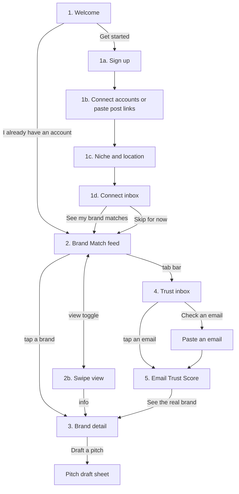
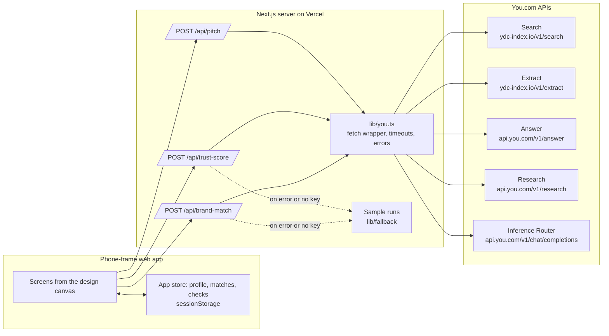

# Vetted: build plan, user flow and architecture

Vetted is a mobile-first web app for creators with two features:

- **Brand Match**: brands that fit the creator's last 7 or 30 days of content, what they pay creators, and whether they are hiring now.
- **Trust Score**: rates a brand, manager or promo email from 0 to 100 (Looks safe / Check first / Risky), with a source behind every finding.

Every number comes from You.com, live. When a call fails or no key is set, the app falls back to a saved sample run and says so with the "Sample data" pill already in the designs.

## Recommended approach

| Decision | Choice | Why |
| --- | --- | --- |
| App type | Next.js web app, mobile-first, shown in a phone frame on desktop | Matches the 390×844 designs; a native app won't fit the time box; deploys to Vercel in one step |
| Language and UI | TypeScript, React 19, Tailwind CSS v4 | Design tokens from the prototype map 1:1 to Tailwind utilities |
| Server | Next.js route handlers (`src/app/api/*`) | Keeps the You.com key on the server; no separate backend |
| Data provider | You.com only: Search, Extract, Answer, Research, plus the Inference Router for the LLM steps | One key, one bill, and "You.com is the engine" is literally true for judges |
| State | React context persisted to `sessionStorage` | No database needed for the demo; saved brands and checked emails survive a refresh |
| Safety net | Sample JSON for both features, used automatically on failure | Wi-Fi or quota problems never kill the demo |
| Deploy | Vercel, with `YDC_API_KEY` as an environment variable | Free, fast, and gives a public link for Devpost |

## User flow



What runs live and what is designed:

| Step | Live with You.com | Designed (sample) |
| --- | --- | --- |
| Sign up, connect Instagram/TikTok/YouTube, connect Gmail | | Yes, UI only |
| Paste 3 post links in onboarding | Extract reads each post | |
| Brand Match feed | Extract, Inference Router, Search, Answer | Falls back to sample run |
| Brand detail and sources | Answer citations | |
| Pitch draft | Inference Router | |
| Trust inbox | 3 sample emails you can check, plus paste your own | Inbox sync |
| Email Trust Score | Search, Extract, Answer, Inference Router, in parallel | Falls back to sample run |

## Architecture



### Brand Match pipeline (`POST /api/brand-match`)

1. **Read the creator's content**: Extract each pasted post link (parallel). If none are given, use the niches picked in onboarding.
2. **Profile**: the Inference Router turns the text into niche, topics, audience and follower band. Without an LLM, the picked niches stand in.
3. **Find brands**: three Search calls in parallel with week/month freshness: sponsorships, creator programs, and adjacent product categories. Successful lanes are retained if another fails. When Router access is unavailable, one structured Research call provides alternative discovery.
4. **Merge and rank**: one shared Inference Router call identifies brands, assigns content-fit scores, and attaches supporting result indexes. Merge duplicate names/domains and their evidence before capping at 20 brands. Return fewer when evidence is insufficient.
5. **Spend and hiring now**: return the feed without Answer calls. Opening a live brand calls `POST /api/brand-research` for that brand only. Cache completed details in the browser session, preserve discovery sources, distinguish unchecked/failed states, and allow retries. Sample brands never trigger live checks.
6. **Fit score**: the shared model's content-fit score, clamped to 0–100. Fit and feed order stay stable when pay and campaign details arrive.

### Trust Score pipeline (`POST /api/trust-score`)

Five checks run in parallel; each returns points, a finding and sources.

| Check | You.com calls | Weight |
| --- | --- | --- |
| Sender identity: do the sender domain and links match the brand's real site? | Search "<brand> official site", compare domains | 30 |
| Scam reports about the domain or offer | Search, year freshness | 25 |
| Lawsuits and court cases | Answer, year freshness | 20 |
| Manager or agency is real | Search the name with the brand and agencies | 15 |
| Red flags in the email (sign-in links, upfront fees, urgency, downloads) | Rules + Inference Router, no web | 10 |

Bands: 80–100 Looks safe, 50–79 Check first, under 50 Risky. Findings say "public reports found" or "no reports found", never "clean": this is a web check, not a legal one.

## Folder layout

```
vetted/
  src/app/                 screens (one route per artboard) and api/ route handlers
  src/components/          PhoneFrame, TabBar, Pill, ScoreRing, BrandCard, SwipeDeck...
  src/lib/you.ts           You.com client (search, extract, answer, research, chat)
  src/lib/brandMatch.ts    Brand Match pipeline
  src/lib/trustScore.ts    Trust Score pipeline
  src/lib/fallback.ts      sample runs used when the API is unavailable
  src/lib/sampleEmails.ts  the 3 demo emails
  src/lib/store.tsx        client state
```

## Build order

1. Scaffold, tokens, phone frame, shared components.
2. Trust Score: API route, inbox and email screens.
3. Brand Match: API route, feed, swipe and brand detail screens.
4. Onboarding screens (designed), wired to the store.
5. Fallbacks, empty and error states, then deploy to Vercel.

Cut list if behind: drop the spend Answer call first, then the manager check.
